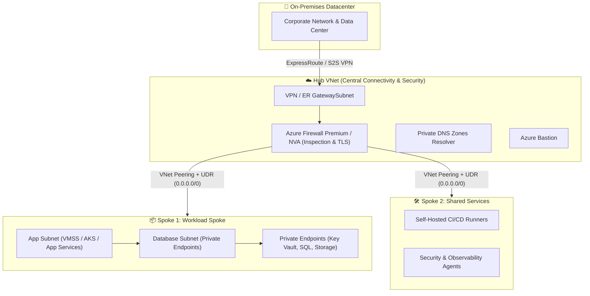
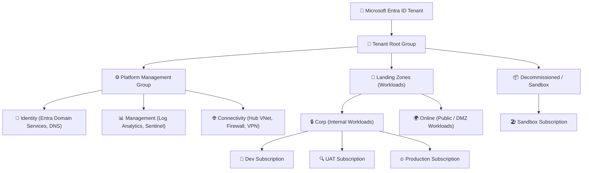
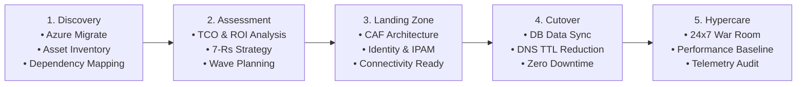
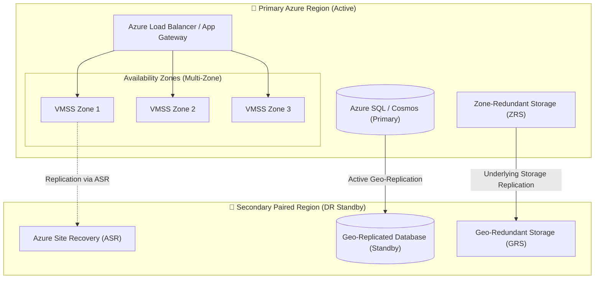

<div align="center">

  <h1>👋 Hi, I'm Subhasish</h1>
  
  <p align="center">
    <a href="https://readme-typing-svg.demolab.com?font=Fira+Code&weight=600&size=22&pause=1000&color=00C2FF&center=true&vCenter=true&width=650&height=50&lines=Senior+DevOps+%26+Cloud+Architect;DevSecOps+%26+Platform+Engineering+Lead;100%2B+Enterprise+Cloud+Migrations;Zero-Trust+Security+%26+Landing+Zones;FinOps+%26+AI-Native+Cloud+Automation">
      
    </a>
  </p>

  <p>
    <strong>Enterprise Cloud Architect • DevSecOps Practitioner • Platform Engineering • FinOps • AI Automation</strong>
  </p>

  <p>
    
    
    
  </p>

  <p>
    <a href="https://linkedin.com/in/"></a>
    <a href="mailto:contact@subhasish.dev"></a>
    <a href="#-architecture--engineering-dna"></a>
  </p>

  <table align="center">
    <tr>
      <td align="center">🏢 <strong>100+ Workloads Migrated</strong><br/>Zero-Downtime Migration Strategy</td>
      <td align="center">🛡️ <strong>Zero-Trust Architecture</strong><br/>Shift-Left DevSecOps & Governance</td>
      <td align="center">💰 <strong>28%+ FinOps Savings</strong><br/>Rightsizing, RIs & Automated Ops</td>
      <td align="center">🤖 <strong>AI-Native Automation</strong><br/>Self-Healing & Agentic Workflows</td>
    </tr>
  </table>

</div>

---

## 📌 Executive Summary & Engineering DNA

I design resilient cloud platforms, architect enterprise landing zones, and automate delivery pipelines for mission-critical modern organizations. With **9.5+ years of total IT experience** including **5.5+ years dedicated to DevOps, Cloud Architecture, and Platform Engineering**, I bridge the strategic gap between high-level business goals and ground-level technical execution.

I don’t just build CI/CD pipelines — **I architect scalable, secure, and self-governing systems that accelerate business velocity and eliminate risk from Day 1.**

---

## 🏛️ The 10 Core Pillars of Scalability & Quality

```
+--------------------------------------------------------------------------------------------------+
|                                    10 Scalability & Quality Pillars                               |
|                                                                                                  |
|  1. Scalable      2. Robust        3. Secure        4. Reliable       5. Portable                |
|  6. Governed      7. High Avail    8. Cost-Optim    9. Backed Up      10. Compliant & Monitored  |
+--------------------------------------------------------------------------------------------------+
```

---

## 🌐 1. Enterprise Hub-and-Spoke Networking Architecture

Centralized ingress, egress, and inter-spoke traffic inspection with Zero-Trust network micro-segmentation:



### Key Architectural Standards
* **IPAM & Non-Overlapping CIDR:** Meticulous address allocation ensuring zero overlapping subnets between on-prem and multi-region Azure VNets.
* **Forced Tunneling via UDRs:** User-Defined Routes forcing all default internet-bound (`0.0.0.0/0`) and spoke-to-spoke traffic through the Azure Firewall / NVA.
* **Zero Public IP Surface:** 100% private PaaS ingestion via **Private Endpoints** and centralized Azure Private DNS Zones.
* **Controlled Ingress/Egress:** WAF-enabled Azure Application Gateway / Front Door for Layer 7 web security; Centralized Egress with SNAT and TLS Inspection.

---

## 🏢 2. Cloud Adoption Framework (CAF) & Governance Hierarchy

A structured tenant, management group, and subscription hierarchy designed for strict blast-radius isolation and automated policy guardrails:



### Governance & Compliance Best Practices
- **Subscription Blast-Radius Isolation:** Workloads separated strictly by environment (`Dev`, `UAT`, `Prod`) and function (`Platform` vs `Workloads`).
- **Policy as Code (Azure Policy Initiatives):** Enforcing **CIS Azure Benchmark** and **Microsoft Cloud Security Benchmark (MCSB)** at Management Group levels with `Deny` and `AuditIfNotExists` effects.
- **Just-In-Time Privilege (PIM):** Microsoft Entra ID Privileged Identity Management with approval workflows, time-bound role activations, and multi-factor authentication.

---

## 🛡️ 3. Shift-Left DevSecOps Pipeline Architecture

Automated Infrastructure as Code (IaC) governance, security scanning, cost forecasting, and release orchestration:

```mermaid
flowchart LR
    Dev["👨‍💻 Engineer"] -->|"Git Commit"| PR["Pull Request (Trunk-Based)"]

    subgraph CI["🔄 Shift-Left Security & Validation CI"]
        PR --> Lint["Lint & Format (tflint, terraform fmt)"]
        Lint --> SecScan["Security Scanners (Checkov, tfsec, Trivy)"]
        SecScan --> Secrets["Secrets Scanning (GitLeaks)"]
        Secrets --> Cost["Cost Estimation (Infracost)"]
        Cost --> Plan["Terraform Plan & Drift Check"]
    end

    subgraph Gate["🛡️ Governance Gate"]
        Plan --> PeerReview["2+ Senior Approvals (CODEOWNERS)"]
        PeerReview --> ChangeApproval["Automated CAB / Approval Gate"]
    end

    subgraph CD["🚀 Automated Delivery CD"]
        ChangeApproval --> Apply["Terraform Apply (Blob State Lock)"]
        Apply --> Telemetry["Drift Telemetry & Observability"]
        Apply -.->|"Failure Detected"| Rollback["Automated Rollback Engine"]
    end
```



### DevSecOps Governance Highlights
- **Trunk-Based Development:** Short-lived feature branches (`feature/*`, `fix/*`) with mandatory PR reviews, branch protection, and code owner sign-offs.
- **Hardened State Storage:** Encrypted Azure Storage Accounts with blob lease locking, RBAC via Managed Identities, and private network restrictions.
- **Continuous Drift Detection:** Nightly scheduled automation pipelines running `terraform plan -detailed-exitcode` to immediately detect and remediate console drift.

---

## 🔄 4. Enterprise 100+ Workload Cloud Migration Playbook

Battle-tested framework for large-scale, zero-downtime datacenter modernization:



### End-to-End Migration Checklist
* **Pre-Migration:** Workload discovery reports, network bandwidth sizing, VM family right-sizing, target Landing Zone certification, and rollback planning.
* **Migration Cutover Window:** Live database replication sync, maintenance window orchestration, DNS failover cutover, and smoke test sign-off.
* **Post-Migration & Hypercare:** Health telemetry audit, latency validation, end-user sanity verification, and 2-4 weeks of dedicated war room support.

---

## 🔒 5. Multi-Layered Defense-in-Depth Security Matrix

| Layer | Key Controls, Policies & Technologies |
| :--- | :--- |
| **Identity & Access** | Microsoft Entra ID, Conditional Access, Multi-Factor Authentication (MFA), Privileged Identity Management (PIM), Managed Identities (No hardcoded credentials). |
| **Network Security** | Hub-and-Spoke topology, NSGs/ASGs micro-segmentation, Azure Firewall Premium with TLS inspection, Private Endpoints, DDoS Protection Standard. |
| **Governance & Policy** | Management Group policy enforcement, CIS Azure Benchmarks, ISO 27001 compliance standards, Microsoft Defender for Cloud Secure Score. |
| **Data & Storage** | Customer Managed Keys (CMK), Azure Key Vault with automated rotation, storage SSE with double encryption, TLS 1.3 enforcement. |
| **Compute & Workloads** | Microsoft Defender for Servers, automated vulnerability scanning, golden images via Packer, Azure Update Manager baseline patching. |

---

## 💰 6. FinOps & Cloud Economics Engineering

Cloud financial governance focused on eliminating waste, driving unit economics, and maximizing ROI:

- **Waste Elimination:** Automated serverless routines discovering and purging orphaned managed disks, unassociated Public IPs, and aged VM snapshots.
- **Resource Rightsizing:** Continuous CPU/Memory percentile profiling to downscale idle instances and eliminate over-provisioning.
- **Commitment Optimization:** 1-Year / 3-Year **Reserved Instances (RI)** and **Azure Savings Plans** tailored for predictable baseline workloads.
- **Non-Prod Auto-Scheduling:** Automated stop/start schedules for Dev and Test environments outside business hours (**saves ~65% on non-prod compute**).
- **Log Ingestion Tuning:** Tailoring Azure Monitor Data Collection Rules (DCR) to filter out high-volume debug logs before reaching Log Analytics.

---

## ⚡ 7. High Availability, BCDR & Reliability Engineering

Architecting systems engineered to survive datacenter disruptions and regional disasters:



### Resilience Standards
- **RTO (Recovery Time Objective):** `< 30 Minutes` for mission-critical core services.
- **RPO (Recovery Point Objective):** `< 5 Minutes` utilizing continuous asynchronous geo-replication.
- **Storage Redundancy Models:** 
  - **LRS:** 3 copies within one datacenter.
  - **ZRS:** 3 copies synchronously across 3 independent Availability Zones.
  - **GRS:** Asynchronous replication to a secondary paired geographical region.

---

## 📊 8. Enterprise Observability & SRE Operations

- **Unified Log Analytics:** Centralized Log Analytics Workspace per enterprise landing zone with centralized retention policies.
- **Azure Monitor Agent (AMA):** Granular data filtering at source via **Data Collection Rules (DCR)** to balance observability depth with log ingestion costs.
- **Intelligent Alerting:** Dynamic Metric Alerts, Health Alerts, and Log Queries routed dynamically via Action Groups to **PagerDuty**, **Slack**, and **Microsoft Teams**.

---

## 🤝 9. Technical Leadership, Governance & Vendor Management

High-impact technology delivery requires rigorous operational governance, structured vendor evaluation, and team upskilling:

```
[ RFI (Request for Information) ]
               │
[ RFP (Request for Proposal) ]
               │
[ Technical Evaluation Matrix (Architecture, Security, FinOps) ]
               │
[ Statement of Work (SOW) & Commercial Negotiation ]
               │
[ Sprint Delivery & Milestone Verification ]
               │
[ Acceptance Criteria Sign-Off & Final Transition ]
```

### Governance Methodologies
* **Statement of Work (SOW) Formulation:** Clear definition of deliverables, SLAs, acceptance criteria, milestone payments, and liability caps.
* **RACI Framework Execution:**
  * **R**esponsible: Engineers executing implementation tasks.
  * **A**ccountable: Lead Architect holding single ownership of delivery success.
  * **C**onsulted: Security, compliance, and enterprise architects providing inputs.
  * **I**nformed: Executive business sponsors and client stakeholders.
* **Mentorship & Knowledge Transfer (KT):** Driving architecture review boards, weekly engineering brown-bags, and comprehensive Architecture Decision Records (ADRs).

---

## 🧰 Tech Stack & Tooling Ecosystem

<div align="center">

| Domain | Technologies |
| :--- | :--- |
| **Cloud Platforms** |   |
| **IaC & Automation** |    |
| **CI/CD & GitOps** |     |
| **Containers & Orch** |    |
| **DevSecOps & Shift-Left** |     |
| **FinOps & Cost Control** |   |
| **Observability** |    |
| **Languages & Scripting** |    |

</div>

---

## 📈 GitHub Stats & Activity

<div align="center">
  
  
</div>

<p align="center">
  
</p>

---

## 💬 Let's Connect

I am open to discussions on **Enterprise Cloud Migrations**, **Zero-Trust DevSecOps Transformations**, **Platform Engineering Leadership**, and **AI-Driven Cloud Operations**.

<p align="center">
  <a href="https://linkedin.com/in/"></a>
  <a href="mailto:contact@subhasish.dev"></a>
</p>

<p align="center">
  <em>"Built for enterprise impact. Engineered for high availability. Designed for the future."</em>
</p>
